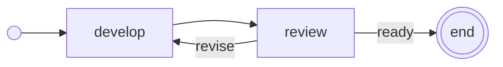

# AgSDL

AgSDL, the Agentic Systems Definition Language, describes **agents** and the
**flows** that connect them, in JSON that people and software can read,
validate and version.

A document says what each agent is, what it may do, which harness runs it,
and how work moves between agents. A harness is the program that runs an
agent: Codex, Claude Code, opencode, pi and others. One flow can mix
harnesses.

## Why

Each harness configures agents in its own format, and work between several
agents is usually wired in code. So:

- what a set of agents does, and in which order, is hidden in that code;
- moving an agent to another harness means rewriting it;
- a promise such as "the reviewer never writes" holds only if the harness can
  enforce it, and nothing checks that it can.

AgSDL puts the agents and the flow between them in one document that people
can review, tools can check and draw, and hosts can run on several harnesses.
Its validator compares each agent with what its harness actually does, before
anything runs.

## Status

| Edition | Status |
| --- | --- |
| **0.3.0** | Draft. Not published. Not compatible with earlier editions. |
| 0.2.0 | Last published edition, tag [`v0.2.0`](https://github.com/Andrologic/AgSDL/tree/v0.2.0). |

AgSDL is not stable. Expect breaking changes until 1.0.

## A first document

A developer on Codex writes a change; a reviewer on Claude Code sends it back
until it is ready.

```json
{
  "contract": "agsdl-0.3.0",
  "id": "write-and-review",
  "title": "Write and review",
  "description": "A developer writes a change; a fresh reviewer sends it back until it is ready.",
  "agents": {
    "developer": {
      "harness": "codex",
      "instructions": "Implement the request, then run the tests.",
      "permissions": "workspace",
      "completionCheck": { "command": "npm test" }
    },
    "reviewer": {
      "harness": "claude-code",
      "instructions": "Review the change. Choose ready or revise.",
      "permissions": "read-only"
    }
  },
  "flow": {
    "entry": "develop",
    "steps": {
      "develop": { "type": "agent", "agent": "developer", "next": "review" },
      "review": {
        "type": "agent",
        "agent": "reviewer",
        "instance": "new",
        "next": { "revise": "develop", "ready": [] }
      }
    }
  }
}
```

It is [`examples/write-and-review.json`](examples/write-and-review.json).
The renderer draws its flow:



Validate it with Python 3.9 or newer, without any package to install:

```sh
cd tooling
python3 -m agsdl ../examples/write-and-review.json
```

The validator checks the document and compares each agent with its
[harness module](harnesses/README.md). It never runs anything.

## What the validator catches

The reviewer is `read-only`: it may read, never write or run commands. Move it
to pi, which has no permission rules:

```json
"reviewer": {
  "harness": "pi",
  "instructions": "Review the change. Choose ready or revise.",
  "permissions": "read-only"
}
```

```text
review-on-pi.json: invalid (3 errors, 0 warnings)
  error    HARNESS_UNSUPPORTED      /agents/reviewer/permissions  pi cannot enforce 'deny' for 'write'
  error    HARNESS_UNSUPPORTED      /agents/reviewer/permissions  pi cannot enforce 'deny' for 'shell'
  error    HARNESS_UNSUPPORTED      /agents/reviewer/permissions  pi cannot deny reads outside the zone; set "outside": "read" or use another harness
```

The document asks for a guarantee that pi cannot give, so the validator
refuses it, instead of letting the reviewer run with more rights than it
seems to have. The same check tells you which `deny` rules Codex can enforce,
whether a model can be the reviewer on a given harness, or which effort
levels a harness accepts.

## Where to go next

| You want to | Read |
| --- | --- |
| Write a first document | [Quickstart](docs/quickstart.md) |
| Understand the language | [Specification](spec/README.md) |
| See complete documents | [Examples](examples/README.md) |
| Know what a harness supports | [Harness modules](harnesses/README.md) |
| Validate or draw a document | [Tooling](tooling/README.md) |
| Test another implementation | [Conformance cases and run scenarios](conformance/README.md) |
| Know what is still open | [Open questions](spec/open-questions.md) and [roadmap](ROADMAP.md) |
| Contribute | [Contributing](CONTRIBUTING.md) |

## Repository

| Directory | Content |
| --- | --- |
| `spec/` | The specification of the current edition. |
| `schema/` | JSON Schemas for documents, harness modules and run scenarios. |
| `harnesses/` | One module per supported harness. |
| `examples/` | Complete, valid documents. |
| `tooling/` | The reference validator and a Mermaid renderer. |
| `conformance/` | Test documents with their expected diagnostics, and run scenarios for hosts. |
| `docs/` | Scope, quickstart and design decisions. |

Earlier editions, their reports and their history are available from their
Git tags.

## License

See [LICENSE](LICENSE).
