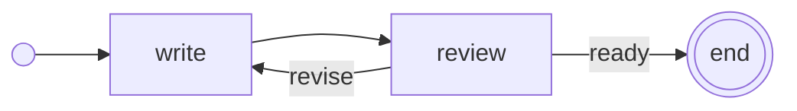

# Quickstart

This guide writes a small AgSDL document, validates it, and reads the
diagnostics. You need Python 3.9 or newer. Run the commands from `tooling/`.

## 1. One agent

Create `/tmp/hello.json`, outside the repository:

```json
{
  "contract": "agsdl-0.3.0",
  "id": "hello",
  "agents": {
    "helper": {
      "harness": "claude-code",
      "instructions": "Answer questions about this repository. Do not change files.",
      "permissions": "read-only"
    }
  }
}
```

```sh
python3 -m agsdl /tmp/hello.json
```

```text
/tmp/hello.json: valid (0 errors, 0 warnings)
```

This document has no flow. It defines one agent that a host can start and send
messages to. `harness` says which program runs the agent; the validator checks
the agent against the
[Claude Code module](../harnesses/claude-code/module.json).

## 2. A diagnostic

Ask for an effort level Claude Code does not have:

```json
"model": { "name": "example/large", "effort": "extreme" }
```

```text
/tmp/hello.json: invalid (1 errors, 0 warnings)
  error    HARNESS_VALUE            /agents/helper/model/effort  claude-code accepts low, medium, high, xhigh, max; got 'extreme'
```

Each diagnostic gives its severity, a code, where it is, and what to fix.
Errors make the document invalid; warnings do not. The model name itself is
never an error: models change too fast for a list, so the host checks it when
it launches the document.

## 3. A flow

Add a writer and route the work between the two agents. Replace the content
of `/tmp/hello.json` with:

```json
{
  "contract": "agsdl-0.3.0",
  "id": "hello",
  "agents": {
    "writer": {
      "harness": "codex",
      "instructions": "Write the requested document in docs/.",
      "permissions": "workspace"
    },
    "helper": {
      "harness": "claude-code",
      "instructions": "Review the document. Choose ready or revise, and explain why.",
      "permissions": "read-only"
    }
  },
  "flow": {
    "entry": "write",
    "steps": {
      "write": { "type": "agent", "agent": "writer", "next": "review" },
      "review": {
        "type": "agent",
        "agent": "helper",
        "instance": "new",
        "next": { "ready": [], "revise": "write" }
      }
    }
  }
}
```

- The keys of `review.next` are the reviewer's **choices**. The reviewer
  submits one with the `agsdl_submit_result` tool, and the flow follows it.
- `"instance": "new"` gives the reviewer a fresh conversation for each review.
  The writer keeps one conversation: on `revise`, it continues the same
  mission.
- `"ready": []` ends the run.

## 4. Draw it

```sh
python3 -m agsdl.mermaid /tmp/hello.json
```



The renderer draws the authored steps and routes. A choice whose route is
empty leads to the end.

## Next

- The [examples](../examples/README.md) show parallel reviews, one worker
  per file, steering, calls, approvals and compositions.
- The [specification](../spec/README.md) defines every field.
