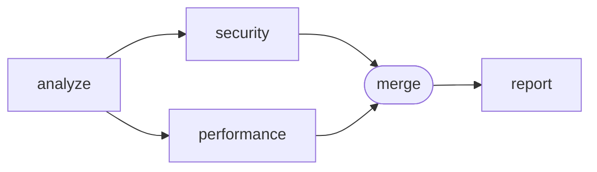

# Flow

A flow moves work between agents. Each step either **works** (an agent, a
call, an approval, a composition) or **routes** (a join). Routes carry
messages from one step to the next.

```json
"flow": {
  "entry": "write",
  "steps": {
    "write":  { "type": "agent", "agent": "writer", "next": "review" },
    "review": { "type": "agent", "agent": "reviewer", "instance": "new",
                "next": { "revise": "write", "ready": "publish" } },
    "publish": { "type": "call", "command": "make publish" }
  }
}
```

## Flow shape

| Field | Content |
| --- | --- |
| `entry` | The first step. It cannot be a join. |
| `steps` | The steps, by name. |
| `onError` | Optional. The default error route of the flow. See [Failures](#failures). |

A **run** starts when the host delivers its entry message to the entry step.
How it proceeds, ends and fails is set by the
[execution model](#execution-model). Every step MUST be reachable from
`entry`, or from the flow's `onError`, through normal or error routes.

### Step types

| Type | Kind | Purpose |
| --- | --- | --- |
| [`agent`](#agent) | work | Gives a mission to an agent instance. |
| [`call`](#call) | work | Runs a command or an MCP tool, without a model. |
| [`approval`](#approval) | work | Asks a person to choose how the flow continues. |
| [`compose`](#compositions) | work | Runs a composition. |
| [`join`](#joins) | route | Waits for parallel branches. |

Every step MAY have `title` and `description`, for people, and `maxVisits`,
see [Loops](#loops).

## Execution model

Five rules give every flow its meaning. The sections below detail each
construct; where a combination of constructs is not described, these rules
decide it.

1. **A step is one unit of work.** When a message starts a step, the step does
   one work and ends with exactly one outcome: a normal route, a failure, or a
   cancellation by a join. A compose step is no exception: its body is its
   work, and it leaves at most once, through one output or as a failure; a
   body path that ends without reaching an output ends the compose step's
   path, as an empty route does. A join does no work of its own; it closes a
   group (rule 3).
2. **A failure goes to the nearest handler.** A failing step follows its
   `onError`. Without one, the failure goes to what encloses the step most
   closely: its join branch, which fails; otherwise its compose step, which
   fails in turn under this rule; otherwise the flow, whose `onError` covers
   top-level steps. A failure that reaches no handler ends its path. A failure
   never undoes effects and never retries on its own.
3. **Parallel paths meet in groups.** A route that starts several targets,
   or one target once per element of a list, starts parallel paths. Paths
   that meet at a join are the branches of a group, opened by the join's
   origin; the join decides once per group. Once it has decided, or the group
   has closed or failed, nothing of the group routes outside its branches
   again: its unfinished branches are cancelled, or finish inside themselves
   without counting for the flow, as the join's `remaining` says, and its
   fan-out elements not yet started never start. Paths that meet no join end
   on their own, except in a composition body, where every fork is closed by
   one join (rule 1).
4. **An instance does one work at a time.** A message for a working instance
   waits its turn, or, with `steer`, joins the current work if that work still
   counts for the flow. A message that joins a work has no outcome of its own:
   its path ends there. Shared and named instances keep their conversation
   from one work to the next until the run ends.
5. **A run fails when a failure that counts reaches no handler.** The run ends
   when no work is active or waiting. It fails if a failure reached no
   handler, other than in work that no longer counts for the flow; otherwise
   it succeeds.

## Routes

`next` and `onError` hold routes. A **target** is a step name, or an object
that also carries a [message](#messages):

```json
"next": "review"
"next": { "step": "review", "message": { "prompt": "Review the change below." } }
```

A route is a target, or a list of targets. A list starts every target at once:

```json
"next": ["security", "performance"]
```

An empty list, or an absent `next`, ends this path of the run.

### Fan-out

A target object MAY have `each`, a selection path into the output of the step
the route leaves, as in [`from`](#messages). The value there is a list. The
target starts once per element, at once, in list order: a **fan-out**.

```json
"plan": {
  "type": "agent",
  "agent": "lead",
  "next": { "split": { "step": "fix", "each": ["results", "files"] } }
},
"fix":    { "type": "agent", "agent": "worker", "instance": "new", "next": "gather" },
"gather": { "type": "join", "failures": "keep", "next": { "done": "summary", "incomplete": "plan" } }
```

- Each start receives the route's message, default or explicit, plus
  `resources.item`, the element. In that message, a selection that starts
  with `"item"` reads in the element, for example
  `{ "from": ["item", "file"] }`; validators check it against the list's
  declared schema.
- An element is information, like the output it comes from. When the fan-out
  reads the `instructions` of an agent that
  [instructs](agents.md#instructing-other-agents), `"each": ["instructions"]`,
  each element is a mission instead: it is the prompt of the default message
  of its path, and an explicit message can select it with
  `"prompt": { "from": ["item"] }`. The other targets of that route cannot use
  the instructions as one prompt (`MESSAGE_PATH`).
- `concurrency`, a positive integer, is the most paths of this fan-out that
  run at once. Elements start in list order as paths end. Without it, the
  document sets no limit. Like permissions, it is a ceiling: a host MAY run
  fewer paths at once, never more. `concurrency: 1` runs the elements one
  after the other, each seeing what the previous one did.
- `max`, a positive integer, is the most elements a fan-out accepts. It
  bounds lists that no schema bounds, such as call data. For an agent's
  result, `maxItems` in its schema is better: a list that is too long is
  corrected at submission instead of failing.
- `concurrency` and `max` require `each` (`ROUTES`).
- A fan-out that cannot start fails before anything starts: when the list is
  longer than `max` (`FANOUT_LIMIT`), or when the value is not a list or
  cannot be read (`OPERAND`). As with [`maxVisits`](#loops), no branch of the
  route starts, not even its fixed targets, and the join that would close
  them fails with that code, which it handles like any step. Without such a
  join, the target fails once with that code.
- An empty list starts nothing. A join that closes the fan-out still decides
  at once: `done` in all mode, `missed` for a quorum it cannot reach, with an
  empty list for the branch. To refuse an empty list, declare `minItems` in
  the result's [schema](agents.md#value-schemas): the agent's submission is
  then corrected before the flow goes on. To route "nothing to do" elsewhere,
  give the agent a choice for it.
- `each` targets an agent, an approval or a compose step. A call or a join
  receives no message, so it cannot tell elements apart (`ROUTES`).
- Each start is a visit of the steps it reaches: with 30 elements, `fix`
  starts 30 times toward its `maxVisits`. An element that never starts is
  not a visit. Validators warn when a step in the paths of a fan-out has a
  `maxVisits` below the fan-out's `max`, or has one while the fan-out has no
  `max` (`FANOUT_VISITS`). To bound how often the work is
  started again, put `maxVisits` on the step that fans out.
- The paths of a fan-out are parallel paths ([rule 3](#execution-model)).
  They meet at a join as one [fan-out branch](#origin-and-branches).
  Validators check `each` like a selection, and report a declared value that
  is not a list (`MESSAGE_PATH`).

### Choices

A step that routes by choice has a `next` map. Its keys are the step's
**choices**:

```json
"next": { "revise": "write", "ready": ["publish", "notify"], "blocked": [] }
```

When an agent's work can lead to different steps, routing is always by
choice: the agent submits one of the keys with the
[result tool](agents.md#the-result-tool). Nothing else in an agent's output
selects a route. The criteria for choosing
belong in the agent's instructions or in the message, not in the route.
Choices follow the [choice naming rule](document.md#names). An
[approval](#approval) routes by choice too: the choices are offered to a
person. [Calls](#call) and [joins](#joins) route by their **outcomes**,
defined below.

## Messages

A message has a `prompt`, the mission, and `resources`, information.

```json
"message": {
  "prompt": "Fix the failing tests below. Keep completed work.",
  "resources": {
    "failures": { "from": ["data", "output"] },
    "guide":    { "ref": "testing-guide" }
  }
}
```

| Field | Content |
| --- | --- |
| `prompt` | A string, or a list of content sources, written by the document author; or a selection of an [instructing agent's](agents.md#instructing-other-agents) `instructions`. |
| `resources` | Named content sources, or selections from the previous step's output. |

A **selection** `{ "from": [...] }` reads a value from the output of the step
the route leaves. The path is a list of object keys and array indices. An
optional `mediaType` describes the selected value. When the path designates an
agent result whose media type is neither JSON nor text, the resource is that
file, by reference, with its media type. Otherwise the resource is the selected
value, inline.

When a route has no `message`, the target receives the **default message**:

| Previous step | Default message |
| --- | --- |
| Host, at entry | The message supplied by the host. |
| Agent | `resources.text` with the agent's text, and one resource per accepted result, under the result's name. The prompt is the agent's `instructions` when it [instructs](agents.md#instructing-other-agents); otherwise there is none. |
| Call | `resources.result` with the call's `data`. |
| Join | One resource per branch, under the branch name, with the branch output. No prompt. |
| Approval | The message it received, plus `resources.comment` with the person's comment when it is not empty. |
| Composition | The default message of the body step that left the composition. |
| Error route | `resources.error` with the [error](#failures). |

An explicit `message` replaces the default message entirely. A prompt
selection reads `["instructions"]` from an instructing agent,
`["branches", "<branch>", "instructions"]` from a join, since no prompt
crosses a join by itself, or `["item"]` in a
[fan-out over instructions](#fan-out).

A message can target an agent, an approval or a composition. A message on a
route to a call or a join is an error: they have nothing to deliver it to.

Validators check that each selection path exists in the declared output of
the step it reads from, as far as declarations allow. A path that
cannot be read when the run reaches it fails the step that would receive it,
with `OPERAND`.

### The mission of a step

An agent step MAY have a default `prompt`. The prompt its agent receives is
the first available of:

| Rank | Prompt |
| --- | --- |
| 1 | The prompt of the route's explicit `message`. |
| 2 | The prompt of the default message, when the route has no explicit `message`: the `instructions` of the previous step's agent when it instructs, or its element of them in a fan-out over them, or the prompt an approval passes on. |
| 3 | The step's default `prompt`. |

The receiving agent's standing `instructions` apply above any prompt.

A route **brings a prompt** when its explicit `message` has one, when it leaves
an instructing agent without an explicit `message`, or when it leaves an
approval that every arriving route brings a prompt to. When some routes to an
agent step bring a prompt and others do not, the step MUST have a default
`prompt` (`PROMPT`), so that its mission never depends on where the flow came
from. When every route brings one, or none does, a default prompt is optional.
The message the host delivers at entry is not a route.

## Agent

```json
"review": {
  "type": "agent",
  "agent": "reviewer",
  "instance": "new",
  "next": { "revise": "write", "ready": "publish" },
  "onError": "notify"
}
```

| Field | Content |
| --- | --- |
| `agent` | The agent definition. |
| `instance` | Absent, a name or `"new"`. See [instances](agents.md#definitions-and-instances). |
| `delivery` | `"queue"` or `"steer"`. See [Delivery](#delivery). |
| `prompt` | The default prompt. See [The mission of a step](#the-mission-of-a-step). |
| `timeoutMs` | The most machine time the work may take. See [Time limits](#time-limits). |
| `next` | A route, or a map of choices to routes. |
| `onError` | A route followed when the work fails. |

The output of the step is the [work output](agents.md#the-result-tool):
`text`, `results`, `choice` when the step routes by choice, and
`instructions` when the agent submitted them.

## Delivery

`delivery` matters only when the instance is already working when a message
reaches it.

| `delivery` | Instance idle | Instance working |
| --- | --- | --- |
| `queue` (default) | The work starts. | The message waits until the current work ends, then starts its own work. |
| `steer` | The work starts. | The message joins the current work, whatever step started it, if that work still counts for the flow ([rule 4](#execution-model)). Otherwise it waits, as with `queue`. |

- Each instance processes messages in arrival order. Every message identifies
  its sender to the agent.
- A queued message starts a work of its own: it has its own output and follows
  its own routes.
- A steered message that joins a current work has no output of its own. The
  current work's result and routes apply, not the routes of the `steer` step.
  The `steer` step's `next` is used only when it starts its own work.
- A harness that cannot inject a message into a current work does not support
  `steer`. Its module declares it.
- `delivery` MUST NOT be used with `"instance": "new"`: a fresh instance is
  never working.

When two works on one instance can run at the same time, for example two steps
in two branches of one join, or one step in the paths of a fan-out, and no
step involved declares `delivery`, validators warn that their work will be
serialized (`SHARED_INSTANCE_PARALLEL`). Declaring
`delivery` explicitly states the intent and silences the warning. A branch
that finishes after its join decided is a special case: see
[`remaining`](#waiting-modes).

## Call

A call does work without a model. It runs a command, or a tool of a document
MCP server.

```json
"tests": {
  "type": "call",
  "command": "npm test",
  "next": { "passed": "publish", "failed": "fix" }
}
```

```json
"open-issue": {
  "type": "call",
  "mcp": { "server": "github", "tool": "create_issue" },
  "arguments": {
    "title": { "value": "Nightly build failed" },
    "body":  { "path": ["error", "message"] }
  }
}
```

| Field | Content |
| --- | --- |
| `command` | A shell command, run by the host in the flow's workspace. |
| `parse` | For `command`: `"lines"` or `"json"`, how to read its standard output as `data.value`. |
| `mcp` | `server`, a document MCP server, and `tool`, a tool name. |
| `arguments` | For `mcp`: argument name to [operand](#operands). |
| `timeoutMs` | The most time the call may take. See [Time limits](#time-limits). |
| `next` | A route, taken whatever the outcome, or a map with exactly `passed` and `failed`. |
| `onError` | A route, taken when the call cannot run. |

A call has exactly one of `command` or `mcp`. Its **outcome** is `passed` or
`failed`:

| Call | `passed` | `failed` |
| --- | --- | --- |
| Command | Exit status `0`. | Any other exit status. |
| MCP | A normal tool result. | A tool result marked as an error. |

The output is `{ "outcome": "passed", "data": ... }`:

- **Command**: `data` is `{ "exitCode": 0, "output": "..." }`, where `output`
  combines standard output and standard error. With `parse`, `data` also has
  `value`, read from standard output alone:

  | `parse` | `value` |
  | --- | --- |
  | `"lines"` | A list of strings: the lines of standard output, without their line endings (`\n` or `\r\n`), in order, with empty lines left out. |
  | `"json"` | Standard output parsed as one JSON value. |

  `value` exists whatever the outcome: a test runner that exits with `1`
  can still report in JSON. When standard output is not valid JSON, the call
  fails with `OUTPUT_INVALID`.
- **MCP**: `data` holds the tool result's structured content, or its text
  content when it has none.

```json
"changed": {
  "type": "call",
  "command": "git diff --name-only main",
  "parse": "lines",
  "next": {
    "passed": { "step": "review", "each": ["data", "value"], "max": 100 },
    "failed": "report"
  }
}
```

A `failed` outcome is a normal result, not a failure. A call that cannot run,
because the command cannot start or the MCP server cannot be reached, fails
with `CALL_FAILED`.

Routing on anything finer, such as one exit status among several or a field of
a tool result, is done by a script that exits with `0` or not, or by an agent
that judges the result. A document requests calls; the host decides whether to
run them, as for permissions.

### Operands

An operand is `{ "value": ... }`, a literal, or `{ "path": [...] }`, a value
read from the step's input: the output of the previous step.

## Approval

An approval asks a person to choose how the flow continues.

```json
"approve-release": {
  "type": "approval",
  "title": "Publish the release?",
  "timeoutMs": 86400000,
  "next": {
    "publish": "publish",
    "revise": { "step": "write", "message": {
      "prompt": "The release was not approved. Revise the notes.",
      "resources": { "comment": { "from": ["comment"] } }
    }}
  }
}
```

| Field | Content |
| --- | --- |
| `next` | A map of choices to routes, with at least one choice. |
| `timeoutMs` | Optional. A positive integer. Without an answer in time, the step fails with `APPROVAL_TIMEOUT`. |
| `onError` | A route. |

The host shows the person the message the approval received, its `title` and
`description`, and the choices. The person picks one choice and MAY write a
comment. The output of the step is:

```json
{ "choice": "revise", "comment": "Section 3 is out of date." }
```

`comment` is always present, and empty when the person wrote nothing. Every
choice is a normal answer, not a failure: `approved` and `denied` are only a
common naming.

An approval decides between missions. The [`ask`](agents.md#actions-and-effects)
permission effect decides on one action during a mission.

## Joins

A join waits for branches started in parallel, then continues once.



```json
"analyze":     { "type": "agent", "agent": "lead", "next": ["security", "performance"] },
"security":    { "type": "agent", "agent": "reviewer", "instance": "new", "next": "merge" },
"performance": { "type": "agent", "agent": "reviewer", "instance": "new", "next": "merge" },
"merge":       { "type": "join", "next": "report" }
```

### Origin and branches

A join does not list what it waits for. Validators deduce it from the graph
of the join's **scope**: the flow's steps, or the body of the composition that
contains the join. In that graph, a compose step is one step, whose routes are
its output routes and its `onError`.

- The **origin** of a join is the last step that every path from the scope's
  entry to the join passes through (its immediate dominator, counting normal
  and error routes). Here: `analyze`. Validators report the origin they deduce.
  Steps in the paths of a [fan-out](#fan-out) do not count, since each element
  runs them separately: a join after them closes the fan-out, and its origin
  is the step that fans out, unless the join closes a fork inside one path.
- A **branch** starts at a target of the origin and contains the steps that lie
  on a path from that target to the join. A route from the origin straight to
  the join is a branch without steps.
- A branch is named after its first step. A direct route is named after the
  origin.
- A branch that the origin starts with [`each`](#fan-out) is a **fan-out
  branch**: each element starts one path of it in the group, and the join
  waits for each path, as for a branch of its own.

Each time the origin follows a route, normal or error, that targets at least
one branch, a new **group** opens. The group waits only for the branches the
origin actually started; when a choice starts some branches only, the group
waits for those. A route that targets no branch opens no group. A fan-out
targets its branch even over an empty list: the group then waits for no path
of it, and a group that waits for nothing is complete at once. Each branch
delivers at most one result per group.

### Shape rules

| Rule | Content |
| --- | --- |
| Single entry | No route from outside a branch enters it, except the origin's route to its first step. |
| Disjoint branches | Two branches of one join share no step. They may share an instance. |
| Closed forks | A branch that starts several targets at once closes them with its own join before reaching the outer join. A route of a branch never starts targets inside and outside the branch at once. |
| Real fork | At least one route of the origin starts two branches or more at once, or a fan-out branch. |
| Fan-out | A branch started with `each` by one route of the origin is started with `each` by every route that starts it. |
| Join inputs | Every route into a join is a normal route from one of its branches or from its origin. |
| Reachable quorum | A quorum `count` does not exceed the number of branches. Without a fan-out branch, this is checked statically; with one, each path counts as a branch. |
| Failure handling | `failures` and `maxFailures` apply to all mode only; `maxFailures` requires `failures: "keep"`. |

Two joins can be nested: a join inside a branch has its own origin inside that
branch.

### How a branch ends

| Branch event | Effect on the group |
| --- | --- |
| A route reaches the join | The branch delivers its result: the output of the step that routed to the join. |
| A route ends inside the branch (empty or absent `next`) | The branch ends without a result. |
| A `steer` message is absorbed by a current work | The branch ends without a result, absorbed by the step that owns that work. |
| A route, normal or `onError`, leads outside the branch | The group **closes**. See below. |
| A step fails without `onError` | The branch fails. |

When a route leaves a branch, the group closes: the join will deliver nothing
for it, other branches follow `remaining`, and the run continues at the route's
target with the route's message only.

### Waiting modes

**All** (default): the join waits for every started branch. `failures` says
what a branch failure does:

| `failures` | Effect |
| --- | --- |
| `fail` (default) | The group fails at once: see [join failures](#join-failures). |
| `keep` | The failure is kept in the join output, and the join goes on waiting for the other branches. With `maxFailures`, a positive integer, the failure that exceeds it fails the group as with `fail`. |

Its route is a target or list, or a map with the single key `done`. With
`failures: "keep"`, the map has exactly `done` and `incomplete`: `done` when
no branch failed, `incomplete` when at least one did. `incomplete` is a normal
outcome, not a failure: a later step can start the failed work again, as a
loop. A failure never retries on its own.

**Quorum**: the join continues as soon as enough branches have delivered an
accepted result.

```json
"vote": {
  "type": "join",
  "quorum": { "count": 2, "accept": ["approve"] },
  "remaining": "stop",
  "next": { "reached": "publish", "missed": "revise" }
}
```

- A branch result is **accepted** when its output has a `choice` listed in
  `accept`.
- `reached`: `count` accepted results arrived.
- `missed`: reaching `count` is no longer possible. This is a normal outcome,
  not a failure.
- A branch that ends without a result counts as not accepted.
- "First acceptable result" is a quorum with `count: 1`.
- `next` is a map with exactly `reached` and `missed`.

`remaining` says what happens to unfinished branches once the join has
decided, or once the group closes or fails:

| `remaining` | Effect |
| --- | --- |
| `stop` (default) | Their work is cancelled: current works stop, with everything they started, such as background commands and sub-agents; their messages still waiting in an instance queue are withdrawn, and their pending approvals and calls are cancelled. The run continues once they have stopped. Cancelling ends a work, not a shared or named instance, which keeps its conversation; a `"new"` instance is discarded. |
| `finish` | The run continues at once. They go on, loops included, and end when they would reach the join or leave the branch. Nothing they produce is used. |
| `wait` | As with `finish`, but the run continues only once they have ended. |

Once the join has decided, or the group has closed or failed, an unfinished
branch never routes outside itself: a cancelled work follows neither `next` nor
`onError`, and a finishing branch, under `finish` or `wait`, that fails ends
there. Its results never count for a later group of the join. An element of a
fan-out that has not started never starts, whatever `remaining` says: with
`concurrency: 1` and a quorum of one, elements are tried in order until one is
accepted. Works of other steps on the same
instances are not affected.

`finish` and `wait` let work with effects, such as edits or a deployment,
complete instead of being cut off, and keep the results of late branches in
the run's record. With `finish`, steps after the join run at the same time as
the finishing branches; with `wait`, nothing after the join starts until they
have ended. A finishing branch no longer counts for the flow
([rules 3 to 5](#execution-model)):

- A `steer` message does not join its work: the message waits for that work
  to end, then starts its own work. Validators warn when a step after a
  `finish` join shares an instance with one of its branches and does not
  declare `delivery: "queue"` (`SHARED_INSTANCE_PARALLEL`).
- When it fails, the host reports the failure; the run does not fail for it.
- The run does not end before it does, and its works count toward
  `maxVisits`.

### Join output

```json
{
  "outcome": "done",
  "branches": {
    "security": { "text": "...", "results": {}, "choice": "approve" },
    "style":    { "ended": "absorbed", "by": "develop" }
  }
}
```

`outcome` is `done`, `incomplete`, `reached` or `missed`. `branches` holds
each branch's output, or `{ "ended": "without-result" }`, or
`{ "ended": "absorbed", "by": "<step>" }`, or, in quorum mode and with
`failures: "keep"`, `{ "ended": "failed", "error": { ... } }`. With `reached`,
it holds the accepted results only. With `done`, `incomplete` and `missed`, it
holds every branch that ended.

A fan-out branch holds a list, one entry per path that ended, in the order of
the elements. Each entry also has `item`, the element:

```json
"fix": [
  { "item": "src/a.ts", "text": "...", "results": {} },
  { "item": "src/b.ts", "ended": "failed", "error": { "code": "AGENT_FAILED", "message": "..." } }
]
```

A selection reads one entry by its index, for example
`["branches", "fix", 0, "results"]`.

### Join failures

A branch failure reaches its join first ([rule 2](#execution-model)). In all
mode with `failures: "fail"`, the group fails at once: other branches follow
`remaining`, and the join fails with `BRANCH_FAILED`, which it handles like
any step. The error details name the branch and its error. With
`failures: "keep"`, the same happens to the failure that exceeds
`maxFailures`; earlier failures are kept. In quorum mode, a failed branch
counts as not accepted. A kept failure is handled: it does not fail the run
([rule 5](#execution-model)).

## Compositions

A composition is a reusable flow fragment.

```json
"compositions": {
  "triple-review": {
    "parameters": ["reviewer"],
    "entry": "spread",
    "steps": {
      "spread": { "type": "agent", "agent": { "parameter": "reviewer" },
                  "next": ["r1", "r2", "r3"] },
      "r1": { "type": "agent", "agent": { "parameter": "reviewer" }, "instance": "new", "next": "vote" },
      "r2": { "type": "agent", "agent": { "parameter": "reviewer" }, "instance": "new", "next": "vote" },
      "r3": { "type": "agent", "agent": { "parameter": "reviewer" }, "instance": "new", "next": "vote" },
      "vote": { "type": "join", "quorum": { "count": 2, "accept": ["approve"] },
                "next": { "reached": { "output": "approved" }, "missed": { "output": "rejected" } } }
    },
    "outputs": ["approved", "rejected"]
  }
}
```

```json
"review": {
  "type": "compose",
  "composition": "triple-review",
  "agents": { "reviewer": "code-reviewer" },
  "next": { "approved": "publish", "rejected": "write" }
}
```

| Composition field | Content |
| --- | --- |
| `title`, `description` | Optional. Text for people. |
| `parameters` | Names of agent parameters. |
| `entry` | The first body step. |
| `steps` | Body steps, of any type, including joins and compositions. |
| `outputs` | Names of the exits. |

| Compose step field | Content |
| --- | --- |
| `composition` | The composition to run. |
| `agents` | Exactly one agent per parameter: an agent definition name or, inside a composition, `{ "parameter": "name" }` to pass one of its own parameters on. |
| `next` | A map with exactly the composition's outputs. |
| `onError` | A route followed when the body fails. |

- A body step names an agent directly, or `{ "parameter": "name" }`.
- A body route targets a body step or `{ "output": "name" }`, which leaves the
  composition through the compose step's route for that output. An output
  target carries no message: the compose step's route carries it.
- That route leaves, in effect, the body step that left the composition. Its
  selections read that step's output, its default message is that step's
  default message, and it [brings a prompt](#the-mission-of-a-step) when a
  route from that step would. The output of a compose step is the output of
  that body step.
- Every output is used by at least one body route.
- A composition leaves at most once per entry, like a step: through one
  output, or through the compose step's `onError`. So a body route, normal or
  `onError`, that starts several targets at once, or a fan-out, starts the
  branches of one join, whose origin is that step (`COMPOSITION`). A branch that leaves
  through an output closes its group, and a branch failure reaches the join.
- A body failure that nothing in the body handles fails the compose step,
  which then follows its own `onError`, or, without one, fails like any step
  ([rule 2](#execution-model)).
- Compositions may use other compositions, but never themselves, directly or
  through others.
- Each use is expanded separately. A body step is addressed by the list of step
  names leading to it, for example `["review", "vote"]`.
- Instances follow the [general rule](agents.md#definitions-and-instances):
  the same definition and instance mean the same conversation, inside or outside
  compositions.
- A message on the route into a compose step is delivered to the body's entry.

## Loops

A route may return to an earlier step. `maxVisits`, a positive integer, limits
how many times a step starts work in one run. Starting work beyond the limit
fails the step with `VISIT_LIMIT`, without doing the work. For a join,
`maxVisits` counts groups: when its origin follows a route that targets
branches and the limit is reached, the branches do not start and the join
fails with `VISIT_LIMIT`.
Without `maxVisits`, there is no limit.

## Time limits

`timeoutMs`, a positive integer, bounds the machine time of an agent's or a
call's work. When it runs out, the host cancels the work as a join's
`remaining: "stop"` does, and the step fails with `TIMEOUT`.

The clock measures the work, not waits that are not its own:

- It starts when the work starts, not while a message waits in an instance
  queue or an element waits for a fan-out's `concurrency`.
- It stops while a request that the host has put to a person for this work is
  open: an `ask` answered by a person, a `planFirst: "ask"` plan reviewed by a
  person, or any other question the host presents to a person. The host
  presents these requests, so it knows when each opens and closes. While at
  least one is open, the clock stands still. An `ask` answered by a model is
  machine time.
- When the harness does not say which work a request is for, as when an MCP
  server asks a question, the host counts it as open for each work that has a
  call to that server in progress, for as long as the call lasts. Failing
  that, it counts it for each work whose agent uses that server.
- Corrections and `steer` messages belong to the same work and do not restart
  it.

A person's slowness is never a `TIMEOUT`. To bound how long an agent's work
waits for a person, use the agent's
[`answerTimeoutMs`](agents.md#waiting-for-a-person). An
[approval](#approval) has its own `timeoutMs`, since waiting for a person is
its work.

## Failures

A failing step follows its `onError` route with this input:

```json
{ "error": { "code": "OUTPUT_INVALID", "message": "...", "details": [] } }
```

Each detail MAY have `path`, `rule` and `expected`. `message` explains the
failure; it is information, never an instruction.

| Code | Failure |
| --- | --- |
| `AGENT_FAILED` | The agent's work failed, without a more precise code. |
| `HARNESS_REFUSED` | The harness refused what the document asks, at run time. |
| `OUTPUT_INVALID` | The agent needed more than `maxCorrections` corrections of its submissions, or a command's standard output is not the JSON its `parse` declares. |
| `CHECK_FAILED` | The completion check failed more than `maxFailures` times. |
| `PLAN_REJECTED` | A `planFirst: "ask"` plan was refused without comment. |
| `CALL_FAILED` | A call could not run. |
| `OPERAND` | A selection or operand path cannot be read. |
| `CONTENT_UNAVAILABLE` | Content needed for a message cannot be obtained. |
| `APPROVAL_TIMEOUT` | An approval received no answer in time. |
| `TIMEOUT` | An agent's or a call's work ran out of its `timeoutMs`. |
| `BRANCH_FAILED` | A branch of an all-mode join failed, beyond what `failures` and `maxFailures` keep. |
| `VISIT_LIMIT` | Starting the step would exceed `maxVisits`. |
| `FANOUT_LIMIT` | A fan-out's list has more elements than its `max`. |
| `INTERRUPTED` | The host stopped the work before it completed, outside a join's `remaining`. |

- Each work follows its normal route or its error route, once, never both. A
  work cancelled by a join's `remaining` follows neither
  ([rule 1](#execution-model)).
- A step that fails without `onError` fails its join branch, or its compose
  step, whichever encloses it more closely. At the top level, it follows the
  flow's `onError` when that route covers it, as below; otherwise its path
  ends and the run will fail ([rules 2 and 5](#execution-model)). The host
  reports the failure.
- The flow's `onError` is a shorthand: it acts as the `onError` of every
  top-level step without one that is reachable from `entry` through normal or
  error routes, without following the flow's `onError`. A run behaves the same
  when those routes are written on the steps. The steps it targets, and the
  steps reachable only through it, do not use it, so a handler that fails is
  never routed back to itself. A route from the handler back into the flow is
  a loop like any other. `maxVisits` bounds it on a step the shorthand does
  not cover, such as the handler: a covered step would route its own
  `VISIT_LIMIT` failure to the handler. Steps inside a join branch do not use
  the flow's `onError` either; their failure reaches the join first.
- Only [corrections](agents.md#corrections) continue an agent's work after a
  refused submission; a failure never retries on its own.

## Agents without a flow

A host can send a message straight to an agent instance, without a flow: to
the shared instance or a named instance, with `delivery` `queue` or `steer`.
The same delivery rules apply. The work output goes back to the sender. A
fresh `"new"` instance cannot receive such messages: it exists only for one
step's work.
